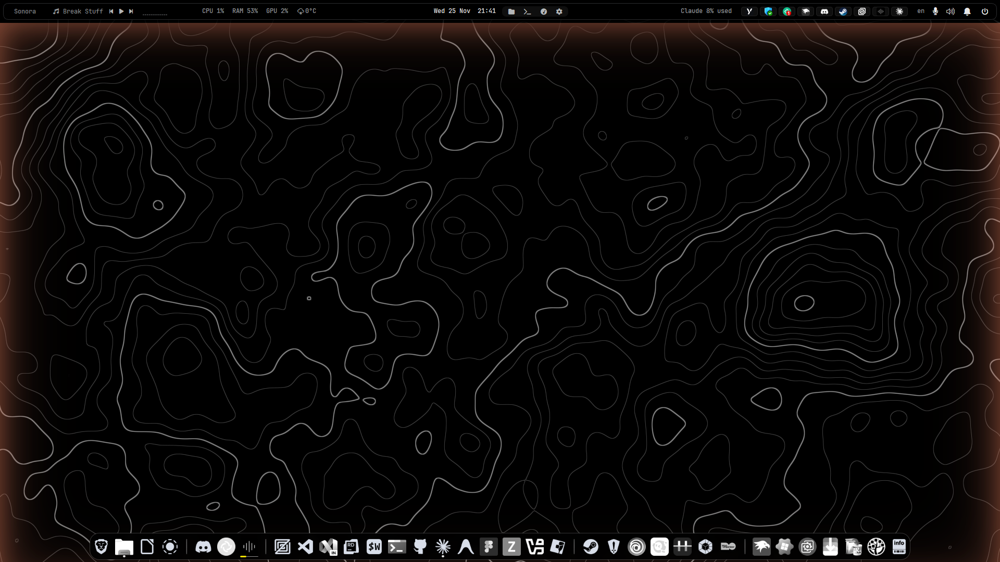

# csps-stratum

> Unified configuration layers, automation scripts, and application profiles orchestrated across desktop, laptop, and mobile devices.

[](#device-profiles-matrix)
[](#the-stratum-model)
[](#license)

`csps-stratum` solves configuration drift across heterogeneous machines. Instead of maintaining monolithic dotfiles or disparate setups per machine, **Stratum** organizes system configurations into modular, composable layers stacked cleanly according to the host platform, form factor, and development workflow.



More in [`docs/screenshots/`](docs/screenshots/). **Want this look?** Clone the repo and give your AI coding agent the prompt in
[`INSTALL-WITH-AI.md`](INSTALL-WITH-AI.md): it checks your system, asks what to keep or change, plans, then builds it.

---

## The Stratum Model

Like geological strata, your working environment is composed of hierarchical layers. Lower strata provide a universal baseline, while higher strata supply platform-specific adaptations and device-level tuning:

```
┌─────────────────────────────────────────────────────────────┐
│                    HOST PROFILES (hosts/)                   │
│         [desktop]        │     [laptop]      │   [mobile]   │
├──────────────────────────┴───────────────────┴──────────────┤
│ 40-apps   │ Editors, top bar & apps (Zed, VS Code, YASB…)   │
│ 30-dev    │ Toolchains & AI assistants (Rust, .NET, Claude) │
│ 20-shell  │ Shell, prompt & terminals (pwsh, WezTerm, OMP)  │
│ 10-os     │ OS integration (WinGet, Scoop, colours, icons)  │
│ 00-base   │ Universal core (Git defaults)                   │
└─────────────────────────────────────────────────────────────┘
```

- **`00-base`**: Foundational conventions shared by every device (Git configuration and LFS filters).
- **`10-os`**: Operating system plumbing (WinGet and Scoop package manifests, Topgrade updater config, the monochrome system colours and the monochrome dock and in-app icons).
- **`20-shell`**: Interactive shell experience (PowerShell 7 profile, Oh My Posh theme, WezTerm, Windows Terminal, Fastfetch; the laptop's zsh and Starship).
- **`30-dev`**: Language toolchains, package managers, and the AI coding assistant configs (Antigravity, Claude Code, Codex).
- **`40-apps`**: Application-level preferences (Zed, VS Code Insiders, Rider, Visual Studio, Windhawk, the YASB top bar, the AI usage widgets, the KDE dock and top bar, the OLED Span wallpaper (Windows, KDE and phone) and the lock, login and splash screens around it, Steam, Sonora, Vencord, Aliucord, Minecraft, gaming and system tools).
- **`hosts/`**: Final overlay matching the exact machine role (workstation desktop, laptop or handheld device). The laptop profile documents its KDE look; the laptop pulls the repo and runs each part's install script (see [Laptop](#laptop-arch-linux)).

---

## Device Profiles Matrix

| Attribute | Desktop (`hosts/desktop`) | Laptop (`hosts/laptop`) | Mobile (`hosts/mobile`) |
|---|---|---|---|
| **Primary OS** | Windows 11 Pro | Arch Linux, KDE Plasma | Android 14 (One UI 6.1) |
| **Form Factor** | Dual-monitor, high-performance workstation | Single screen, battery-constrained | Touchscreen, compact CLI companion |
| **Look** | OLED Monochrome: Windhawk + YASB top bar + native menu bar | OLED Monochrome: KDE colour scheme (the original) + kde-bar top bar + kde-dock | Stock |
| **Power Strategy** | Uncapped performance, GPU acceleration | Battery-aware, aggressive sleep | Minimal background wakeups |
| **Primary Shell** | PowerShell 7 + Oh My Posh | Zsh + Starship | Bash (stock Termux) |
| **Terminal** | WezTerm / Windows Terminal | WezTerm (own config) | Termux |
| **Toolchains** | Full development suites (Rust, Flutter, .NET, Node, Python) | Lightweight dev toolchains, remote SSH | Clang, Node, Python, OpenSSH in Termux |
| **Sync Strategy** | `bin/stratum.ps1 sync` (backup + copy) | `git pull` + each part's install script (`--dry-run` first) | Inventory only (no automated deploy) |

---

## Directory Layout

```
csps-stratum/
├── bin/                     # Entrypoints
│   ├── stratum              # POSIX shell dispatcher (Linux/macOS/Termux)
│   ├── stratum.ps1          # PowerShell dispatcher (Windows)
│   └── greyscale-theme.py   # Turns a colour theme file into greys of the same brightness
├── strata/                  # Composable configuration layers
│   ├── 00-base/git/         # Universal Git configuration (LFS, line endings, identity template)
│   ├── 10-os/windows/       # winget.json, scoop.json, topgrade.toml, monochrome-colors/, dock-icons/, cursors/
│   ├── 20-shell/            # pwsh, oh-my-posh, wezterm, windows-terminal, fastfetch, zsh, starship
│   ├── 30-dev/              # Toolchain manifest & AI assistants (antigravity, claude, codex)
│   └── 40-apps/             # zed, vscode, rider, visual-studio, windhawk, yasb, ai-usage, kde-dock,
│                            # kde-bar, oled-span, steam, sonora, vencord, aliucord, minecraft,
│                            # system-tools, gaming
├── hosts/                   # Machine-specific profiles
│   ├── desktop/             # Workstation profile, profile.yaml, setup.ps1, software-inventory.md
│   ├── laptop/              # KDE Plasma look (OLED_Monochrome.colors, settings), LAPTOP-SETUP.md, ENV.md
│   └── mobile/              # Samsung Galaxy A52s 5G companion profile & package inventory
├── docs/
│   ├── screenshots/         # Reference screenshots of both machines
│   └── superpowers/         # Design notes and plans for the bigger changes
├── INSTALL-WITH-AI.md       # Paste-in prompt for an AI agent to rebuild this setup on your machine
├── .gitattributes           # Line ending & encoding rules (LF on Unix, CRLF on PS1, UTF-16 .reg)
├── .gitignore               # Exclusion of secrets, keys, machine caches, and local agent files
├── LICENSE
└── README.md
```

---

## Quickstart & Bootstrapping

### Windows (PowerShell 7+)

Clone and apply the baseline strata and desktop profile:

```powershell
# 1. Clone to your preferred projects directory
git clone https://github.com/CsPS0/csps-stratum.git "$HOME\Projects\csps-stratum"
cd "$HOME\Projects\csps-stratum"

# 2. Run diagnostic health checks
.\bin\stratum.ps1 doctor

# 3. Check for configuration drift against repository
.\bin\stratum.ps1 diff

# 4. Preview changes safely (-DryRun and -WhatIf are equivalent)
.\bin\stratum.ps1 sync -Profile desktop -WhatIf

# 5. Apply the configuration
.\bin\stratum.ps1 sync -Profile desktop
```

> **Fresh install:** the junk was removed once with [Win11Debloat](https://github.com/Raphire/Win11Debloat) (preinstalled apps, telemetry, ads, Copilot/Recall) and Brave was stripped with [SlimBrave Neo](https://github.com/ChaoticSi1ence/SlimBrave-Neo). Both are third-party, not part of `sync`; see [`strata/10-os/windows/`](strata/10-os/windows/README.md#debloat-one-time-cleanup) for what they do and how to run them.

> **Before step 5:** files in the repository are published copies with personal values removed. `strata/00-base/git/.gitconfig` contains `<YOUR_NAME>` / `<YOUR_EMAIL>` placeholders, and the Sonora and Vencord settings have their account fields blanked. Fill those in locally (without committing them) or restore them from the backup afterwards.

### Laptop (Arch Linux)

The laptop's KDE Plasma 6 setup is listed in [`hosts/laptop/`](hosts/laptop/) (colour scheme, Plasma
style, icons, cursor, fonts, panels, screens). Every script below has a `--dry-run`; run that first.
They back up the config files they change (the AI usage installer just replaces its own installed
copy). In order:

```sh
cd ~/REPOS/csps-stratum && git pull --ff-only

# 1. Wallpaper: the OLED Span Plasma wallpaper plugin
strata/40-apps/oled-span/install-kde.sh --apply

# 2. Top bar and panel look: the bordered OLED-Monochrome Plasma style and the Windows-order bar
strata/40-apps/kde-bar/install-kde-bar.sh --style --layout

# 3. AI usage label in the bar
strata/40-apps/ai-usage/install-kde.sh --add-to-panel

# 4. Dock: swap KDE's task manager for the kde-dock widget (--restore swaps back)
strata/40-apps/kde-dock/install-kde-dock.sh --replace

# 5. Lock screen wallpaper and login splash (no sudo)
strata/40-apps/oled-span/kde-screens/install-kde-screens.sh --lock --splash

# 6. sudo: login screen theme, and the lock screen's blur and clock patch (pacman hook keeps it)
sudo strata/40-apps/oled-span/kde-screens/sddm/install-sddm-theme.sh
sudo strata/40-apps/oled-span/kde-screens/lockscreen/install-lockscreen-noblur.sh

# Editors: Zed theme, then pick "OLED Monochrome" as the dark theme
mkdir -p ~/.config/zed/themes
cp strata/40-apps/zed/themes/oled-monochrome.json ~/.config/zed/themes/

# VS Code Insiders: build and install the theme extension into the CsPS profile
python3 strata/40-apps/vscode/oled-monochrome/pack-vsix.py /tmp/oled-monochrome.vsix
code-insiders --profile CsPS --install-extension /tmp/oled-monochrome.vsix --force
```

What that gives:
- **Top bar** ([`kde-bar/`](strata/40-apps/kde-bar/)), showing the same things as the desktop's bar:
  - left: the focused app's name, the global menu, the playing track with a visualizer, CPU / RAM /
    GPU and the weather;
  - centre: the clock (`2026-11-28  00:44`, a fixed format), the next calendar event and quick-app
    glyphs;
  - right: the Claude / Antigravity usage, the tray and a power button.
  - As on Windows there is no launcher button: Meta opens KRunner.
- **Panels:** both are black, rounded and bordered like the Windows bar and dock.
- **Dock** ([`kde-dock/`](strata/40-apps/kde-dock/)): the same hover magnification as the Windows
  dock, and dividers between app groups.
- **Screens around the desktop** ([`oled-span/kde-screens/`](strata/40-apps/oled-span/kde-screens/)):
  the lock screen and login screen show the contours with no blur and the same clock. The Plymouth
  boot splash is on hold: it booted the main kernel to a black screen.

Then set `"workbench.colorTheme": "OLED Monochrome"` and `"material-icon-theme.saturation": 0` in the
VS Code profile settings. Rider's theme is built by a PowerShell script on Windows. Copy the built jar
to `~/.local/share/JetBrains/Rider<version>/` while Rider is closed, then pick **OLED Monochrome** under
**Settings → Appearance**. The Windows-only strata (Windhawk, YASB, the menu bar, dock icons, system
colours) don't apply.

---

## Key Features

### 1. Non-Destructive Deployment
`setup.ps1` copies files from the active strata into your user profile (`$HOME`, `%APPDATA%`, `$PROFILE`). If a configuration file or folder already exists:
- It is never silently overwritten.
- A timestamped backup is kept first, in `~/.stratum_backups/<yyyyMMdd_HHmmss>/`.
- `-WhatIf` / `-DryRun` previews every step without touching the system.

### 2. Matched Editors
Zed and VS Code Insiders share the same theme, keymap, fonts, layout and equivalent extensions; see [`strata/40-apps/zed/`](strata/40-apps/zed/) and [`strata/40-apps/vscode/`](strata/40-apps/vscode/). Rider and Visual Studio get the same **OLED Monochrome** theme ([`rider/`](strata/40-apps/rider/), [`visual-studio/`](strata/40-apps/visual-studio/)): a greyscale interface on pure black, with syntax and git colours kept.

### 3. One Monochrome Look on Every Machine
The desktop copies the style of the laptop's KDE `OLED_Monochrome` colour scheme without changing its own layout:
- **Shell**: Windhawk overrides make the dock, Start menu, Settings and File Explorer black and grey ([`windhawk/`](strata/40-apps/windhawk/)). The Windows accent, selection and cursor colours are set to match ([`monochrome-colors/`](strata/10-os/windows/monochrome-colors/)).
- **Icons**: monochrome dock, title-bar and Alt+Tab icons ([`dock-icons/`](strata/10-os/windows/dock-icons/)).
- **Top bar**: a macOS-style [YASB](strata/40-apps/yasb/) bar on both monitors, with the clock (`2026-11-28  00:21`), the next Google Calendar event, tray, keyboard layout, microphone, volume, notifications and the Claude / Antigravity quota used ([`ai-usage/`](strata/40-apps/ai-usage/), on the laptop's panel too). A small native menu bar shows the focused app's menus in one line.
- **Terminals and prompt**: WezTerm, Windows Terminal and Oh My Posh use the same palette.
- **Around the desktop**: the lock and sign-in screens show a still of the OLED Span contours on both machines ([`oled-span/`](strata/40-apps/oled-span/README.md#lock-login-and-splash-screens)).

### 4. Strict Secret & Credential Hygiene
No private keys, auth tokens, or passwords are ever stored in this repository:
- All secrets are managed via external password managers or system credential stores.
- Account fields in app configs are left empty or use `<YOUR_…>` placeholders.
- Machine-local overrides are loaded from untracked `*.local.*` files (ignored by `.gitignore`).

---

## AI Agent & Automation Integration

This repository is set up for pairing with AI assistants (Claude Code, Gemini CLI, Google Antigravity, Codex). The agent instruction files (`AGENTS.md`, `CLAUDE.md`, `GEMINI.md`) are kept locally and are not published. They define:

- Zero AI attribution in commits and pull requests.
- Secret safety and placeholder conventions.
- Verification gates (syntax checks and dry runs before anything is declared done).

The assistants' own configs live in [`strata/30-dev/ai/`](strata/30-dev/ai/).

---

## Contributing & Maintenance

1. **Verify Before Committing**: Run syntax and dry-run tests on any modified shell or PowerShell scripts.
2. **Follow Line Ending Standards**: Keep Unix scripts on `LF` and Windows PowerShell scripts on `CRLF`, as governed by [`.gitattributes`](.gitattributes).
3. **No AI Attribution**: Maintain clean git logs without `Co-authored-by` or AI generator trailers.

---

## License

Created by **[@CsPS0](https://github.com/CsPS0)**.  
Released under the [MIT License](LICENSE).
