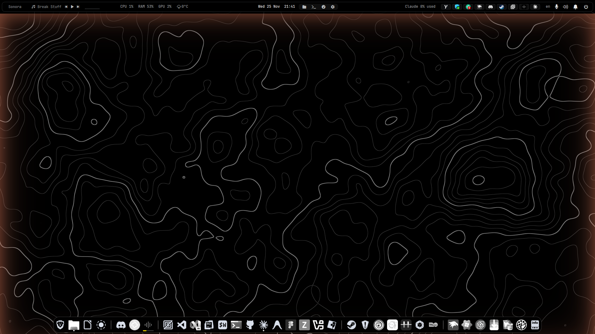

# Desktop Profile (`hosts/desktop`)

This profile standardizes the workstation environment for **Windows 11 Pro**, tailored for multi-display development, GPU acceleration, and a black-and-white **OLED Monochrome** look with a macOS-style top bar and dock.

---

## Hardware & Environment Overview

- **CPU**: AMD Ryzen 5 5600X (6 Cores / 12 Threads)
- **GPU**: NVIDIA GeForce RTX 3070
- **RAM**: 32 GB DDR4
- **Operating System**: Windows 11 Pro 64-bit (Build 26300)
- **Display Matrix**:
  - **Primary Screen (Display 2)**: 1920×1080 @ (X: 0, Y: 0) with centered dock taskbar
  - **Secondary Screen (Display 1)**: 1920×1200 @ (X: 1920, Y: 0) auxiliary canvas

---

## Desktop Aesthetics & Visuals

Wallpaper Engine runs *Orb Spiral - Black Hypnosis* (Workshop ID 3725918788) on the main screen and a
Workshop scene (ID 3557068717) on the second. More shots, including the second screen, are in
[`docs/screenshots/`](../../docs/screenshots/).

---

## Desktop Customization Architecture

| Component | Software / Engine | Configuration & Source |
|---|---|---|
| **Dock / Shell** | [Windhawk](https://windhawk.net/) (v1.7.3) | [`strata/40-apps/windhawk/`](../../strata/40-apps/windhawk/) |
| **Dock Look** | No theme: own rules for a black pill, dots and dividers; monochrome icons | `windows-11-taskbar-styler` ([`oled-dock.reg`](../../strata/40-apps/windhawk/oled-dock.reg)), [`dock-icons/`](../../strata/10-os/windows/dock-icons/), `icon-resource-redirect` |
| **Top Bar** | YASB + native one-line menu bar | [`strata/40-apps/yasb/`](../../strata/40-apps/yasb/) |
| **Wallpaper** | Wallpaper Engine (`wallpaper64`) | Animated backgrounds (Workshop `3725918788`, `3557068717`) |
| **Terminal (Primary)** | [WezTerm](https://wezfurlong.org/wezterm/) | [`strata/20-shell/wezterm/`](../../strata/20-shell/wezterm/) |
| **Terminal (Secondary)** | Windows Terminal | [`strata/20-shell/windows-terminal/`](../../strata/20-shell/windows-terminal/) |
| **Shell & Prompt**| PowerShell 7+ with Oh My Posh | [`strata/20-shell/pwsh/`](../../strata/20-shell/pwsh/), [`strata/20-shell/oh-my-posh/`](../../strata/20-shell/oh-my-posh/) |
| **System Info Banner** | Fastfetch (Totoro ASCII) | [`strata/20-shell/fastfetch/`](../../strata/20-shell/fastfetch/) |
| **Multi-Updater** | Topgrade | [`strata/10-os/windows/`](../../strata/10-os/windows/topgrade.toml) |
| **Base VCS** | Git LFS + Atomic disable | [`strata/00-base/git/`](../../strata/00-base/git/) |
