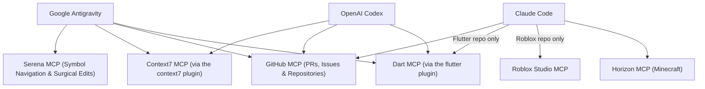

# AI Coding Assistant Stratum

This layer orchestrates the workstation's multi-agent AI coding ecosystem, standardizing shared rules, model settings, plugin manifests, and Model Context Protocol (MCP) servers across **Google Antigravity**, **Claude Code**, and **OpenAI Codex**.

---

## The Triple-Agent Architecture

| Assistant | Engine / Runtime | Configuration File | Focus & Workload |
|---|---|---|---|
| **Google Antigravity** | Gemini 3.8 / 3.x Flash & Pro | [`antigravity.yaml`](antigravity.yaml) | Interactive pair programming, generative UI, real-time workspace analysis, and native Windows integration |
| **Claude Code** | Claude Sonnet (default) with Fable as advisor | [`claude-settings.json`](claude-settings.json), [`claude-skills.yaml`](claude-skills.yaml) | Complex multi-file refactoring, subagent-driven development, deep planning, and graph exploration |
| **OpenAI Codex** | GPT-5 / Codex Runtime | [`codex-config.toml`](codex-config.toml) | Elevated Windows sandbox tasks, computer use, node REPL, and direct editor piping into **Zed** |

---

## MCP Servers

Each assistant gets only the servers it uses. Claude Code scopes the game and Flutter servers to their repos.

## Shared Rules and Skills

- Both Claude Code and Antigravity load the same rules file, `~/.agents/RULES.md`: Claude Code through `@~/.agents/RULES.md` in `~/.claude/CLAUDE.md`, Antigravity through an include in `~/.gemini/GEMINI.md`. It covers Windows shell rules, tool preferences, which agent owns which kind of work, and the `HANDOFF.md` handoff routine.
- Shared skills live once in `~/.agents/skills` and are linked into `~/.claude/skills` and `~/.gemini/config/skills`.
- Claude Code runs a `PreToolUse` guard hook (`~/.claude/hooks/guard-destructive.ps1`) that blocks force pushes and recursive deletes outside the repo root.

---

## Universal Non-Negotiable Hard Rules

Regardless of which assistant is executing a session, all tools adhere to the shared agent rules: `~/.agents/RULES.md` on each machine (Claude Code and Antigravity), plus each repo's local `AGENTS.md`, which is not published:
1. **Zero AI Attribution**: No `Co-Authored-By:` or `Generated with...` lines in commits, pull requests, or code headers.
2. **Absolute Secret Hygiene**: Never commit keys, session tokens, or personal identifiers.
3. **Verify Before Declaring Complete**: Always run local syntax and dry-run tests before concluding work.
