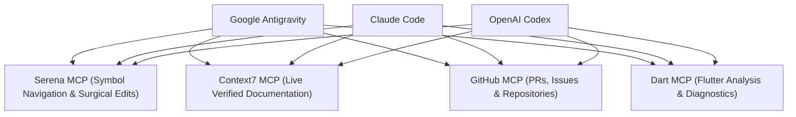

# AI Coding Assistant Stratum

This layer orchestrates the workstation's multi-agent AI coding ecosystem, standardizing shared rules, model settings, plugin manifests, and Model Context Protocol (MCP) servers across **Google Antigravity**, **Claude Code**, and **OpenAI Codex**.

---

## The Triple-Agent Architecture

| Assistant | Engine / Runtime | Configuration File | Focus & Workload |
|---|---|---|---|
| **Google Antigravity** | Gemini 3.8 / 3.x Flash & Pro | [`antigravity.yaml`](antigravity.yaml) | Interactive pair programming, generative UI, real-time workspace analysis, and native Windows integration |
| **Claude Code** | Claude Sonnet 4.5 / Opus 4.5 | [`claude-settings.json`](claude-settings.json), [`claude-skills.yaml`](claude-skills.yaml) | Complex multi-file refactoring, subagent-driven development, deep planning, and graph exploration |
| **OpenAI Codex** | GPT-5 / Codex Runtime | [`codex-config.toml`](codex-config.toml) | Elevated Windows sandbox tasks, computer use, node REPL, and direct editor piping into **Zed** |

---

## Unified MCP Ecosystem

All three assistants share standard access to essential Model Context Protocol servers:

---

## Universal Non-Negotiable Hard Rules

Regardless of which assistant is executing a session, all tools adhere to [`AGENTS.md`](../../../AGENTS.md):
1. **Zero AI Attribution**: No `Co-Authored-By:` or `Generated with...` lines in commits, pull requests, or code headers.
2. **Absolute Secret Hygiene**: Never commit keys, session tokens, or personal identifiers.
3. **Verify Before Declaring Complete**: Always run local syntax and dry-run tests before concluding work.
