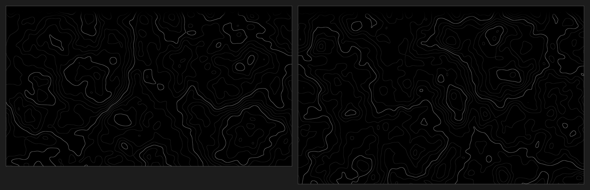

# OLED Span

A procedural black-and-white animated wallpaper, drawn live by a shader instead of being a picture.
Every pixel is worked out from its position on the screen, so it fits any size or aspect ratio
without stretching. It was made for the desktop's mismatched monitors: a 1920x1080 (16:9) main
screen with a 1920x1200 (16:10) screen to its right. Workshop "dual monitor" wallpapers are almost
all 3840x1080 (two equal 16:9 screens), so on this pair they get stretched or cropped. Stretched
across both screens, OLED Span is one continuous image at native resolution; the 120 px strip below
the shorter main screen is drawn but never seen.



| Style | Look |
|---|---|
| Topographic contours (default) | Thin grey contour lines, every fifth one brighter, slowly shifting. |
| Silk | Smoky white sheens folding on black. |
| Halftone | A 24 px dot grid whose dots swell and shrink. |

Every build has the same settings: style, speed, pattern size, brightness, and an option to keep the
strip behind the top bar (or the phone's status bar) dark.

## Builds

| Folder | For | Runs in | Cost, as measured on 22 November 2026 |
|---|---|---|---|
| [`wallpaper-engine-scene/`](wallpaper-engine-scene/) | Windows desktop, both screens | Wallpaper Engine, scene | **In use.** 92 MB RAM, 66 MB video memory, ~0.1% of a CPU core |
| [`wallpaper-engine-web/`](wallpaper-engine-web/) | Windows, any layout | Wallpaper Engine, web (embedded Chromium) | 220-335 MB RAM, 127 MB video memory, ~1% of a core |
| [`kde/`](kde/) | Arch laptop, KDE Plasma 6 | Plasma's own wallpaper system | **In use.** No extra RAM; 15 fps costs ~4% of a core (plasmashell plus KWin) on the HD 630 |
| [`wallpaper-engine-phone/`](wallpaper-engine-phone/) | Android phone, portrait | Wallpaper Engine Android app, scene | Not measured |

The two Wallpaper Engine scene builds share one shader; they differ in canvas size (3840x1200 or
1080x2400), the status-bar strip, and the phone's smaller default pattern size.

## Windows: Wallpaper Engine

1. Copy `wallpaper-engine-scene` (or `wallpaper-engine-web`) to
   `<Steam>\steamapps\common\wallpaper_engine\projects\myprojects\`. It then shows up under
   **Installed**. Or apply it from a terminal:
   `wallpaper64.exe -control openWallpaper -file "<that folder>\project.json"`.
2. In Wallpaper Engine, open the display options at the top and choose **Wallpaper layout →
   Stretch across all monitors**.
3. Select **OLED Span (scene)** and pick a style in the panel on the right.

The web build has two extra settings: **Render resolution** (Auto renders Silk at half resolution)
and **Placement**, for using it per monitor instead of stretched. Set the right monitor's copy to
*Right screen* so the pattern lines up; both copies follow the clock, so they move in step. To
preview it in a browser, serve its folder (`python -m http.server`) and open
`index.html?style=silk&debug=1`. The URL takes the same setting names; `debug` shows the viewport
size and hatches the strip no monitor shows when the window is 3840x1200.

### How the scenes are built

They're hand-written, without the Wallpaper Engine editor. [`scene.json`](wallpaper-engine-scene/scene.json)
sets the canvas size and has one full-canvas image layer per style. Each layer's material
(`materials/oledspan_<n>.json`) sets the shader's `STYLE` combo and binds the sliders to its
uniforms, and the `style` property shows one layer at a time. The shader
([`shaders/oledspan.frag`](wallpaper-engine-scene/shaders/oledspan.frag)) is written in Wallpaper
Engine's dialect (`frac`, `mul`, no `mod`, float literals everywhere so it also compiles as GLSL ES
on phones). On first load Wallpaper Engine compiles it into a `shaders/blobs*/` cache next to it;
that cache isn't kept in the repo. For another monitor pair, change the canvas size in
`scene.json`, the three models, and `CANVAS` in the shader.

## Laptop: KDE Plasma 6

Wallpaper Engine doesn't run on Linux, so the laptop gets a native Plasma wallpaper plugin
(`com.csps.oledspan`): the same shader as a Qt Quick `ShaderEffect`.

```sh
strata/40-apps/oled-span/install-kde.sh --dry-run   # compile the shader, show what would run
strata/40-apps/oled-span/install-kde.sh --apply     # install for this user and use it on every desktop
```

It needs `qt6-shadertools` (for `qsb`) and `kpackagetool6`. When it upgrades an installed copy,
`--apply` also restarts plasmashell, which otherwise keeps running the old QML. The settings,
including **Frames per second** and **Top panel height**, are under **Configure Desktop and
Wallpaper** once OLED Span is selected. The pattern moves slowly, so 15 fps (the default) looks the
same as 30 at half the CPU cost; 10 fps cuts it to ~2.6%. To go back to the image wallpaper, pick
**Image** in the same dialog.

Like the desktop's Wallpaper Engine playback settings (*maximized: pause per monitor*, *fullscreen:
pause all*), it stops animating while a window is maximized on its screen or fullscreen on any
screen, and carries on where it left off. Both are on by default under **Pause**. It watches the
windows through Plasma's task manager model, so minimised windows and other virtual desktops don't
count. **Show Desktop** hides windows without minimising them, so the plugin also follows KWin's
`showingDesktop` flag over D-Bus (`org.kde.plasma.workspace.dbus`; a `SignalWatcher` handler must be
named `dbus` + the signal name) and keeps animating while it is on. Measured on the laptop at 15 fps:

| State | plasmashell CPU |
|---|---|
| No maximized window (animating) | ~2% of one core |
| A window maximized or fullscreen (paused) | 0% |

## Phone: Wallpaper Engine for Android

The free [Wallpaper Engine Android app](https://wallpaperengine.io/android) gets wallpapers from the
desktop app; it can't download them itself.

1. Copy `wallpaper-engine-phone` into `myprojects` on the Windows desktop, as above. It shows up as
   **OLED Span (phone)**.
2. Install the app on the phone. In Wallpaper Engine on the desktop, click **Mobile** (top bar), then
   **Connect new device**, and enter the 4-digit PIN in the phone app. Both need to be on the same
   network.
3. Right-click **OLED Span (phone)** → **Send to mobile device**. If pairing doesn't work, choose
   **Export .mpkg** there instead, copy the file to the phone, and import it in the app.
4. Set it as the wallpaper in the app and pick a style.

The desktop app optimises scenes for phones before sending them. Shaders that compile on Windows
can still fail on a phone's GLSL ES. If it shows black, turn on **Write Errors to Log** in the app's
settings and read the log. The canvas is 1080x2400 (20:9); on other screen shapes it is scaled to fill,
which only crops a little of the pattern.

The simplex noise in the shaders is by Ian McEwan and Stefan Gustavson (Ashima Arts), MIT licence.
